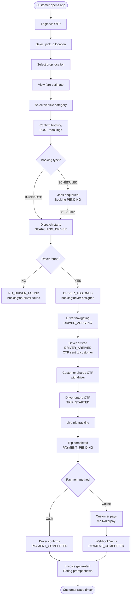
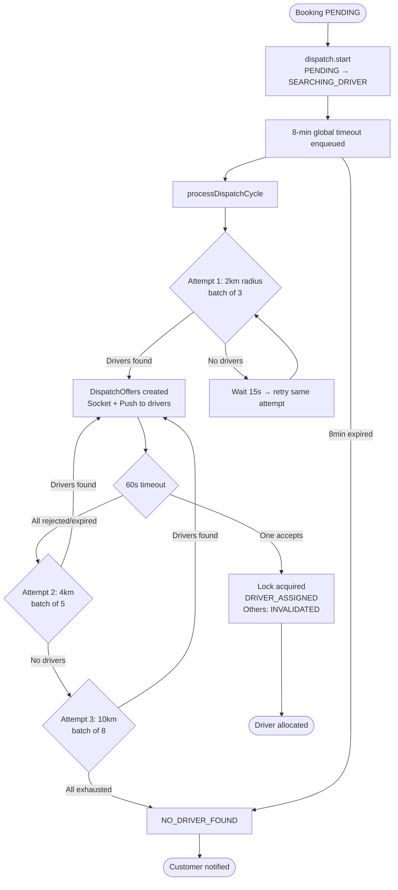
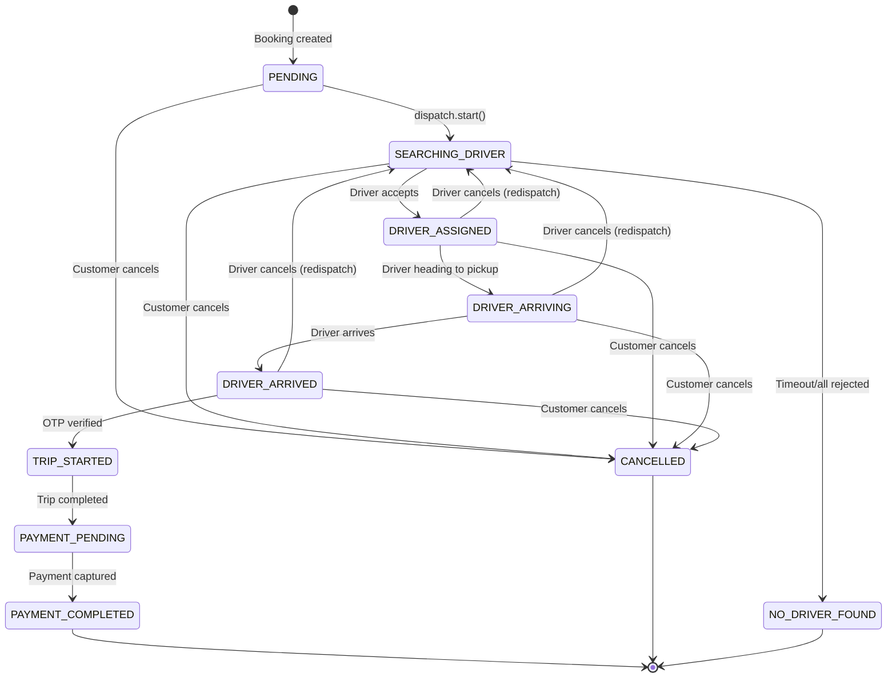
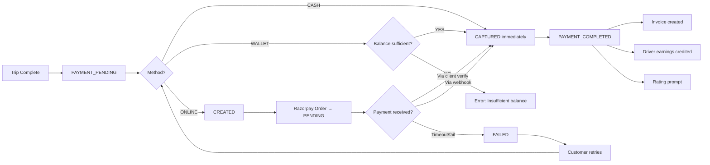
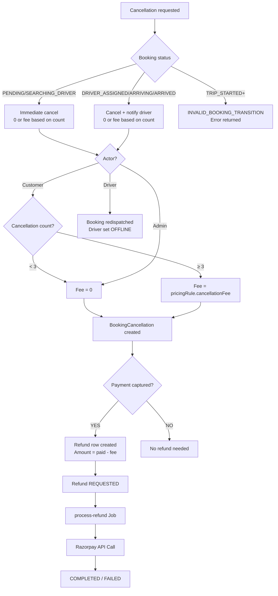
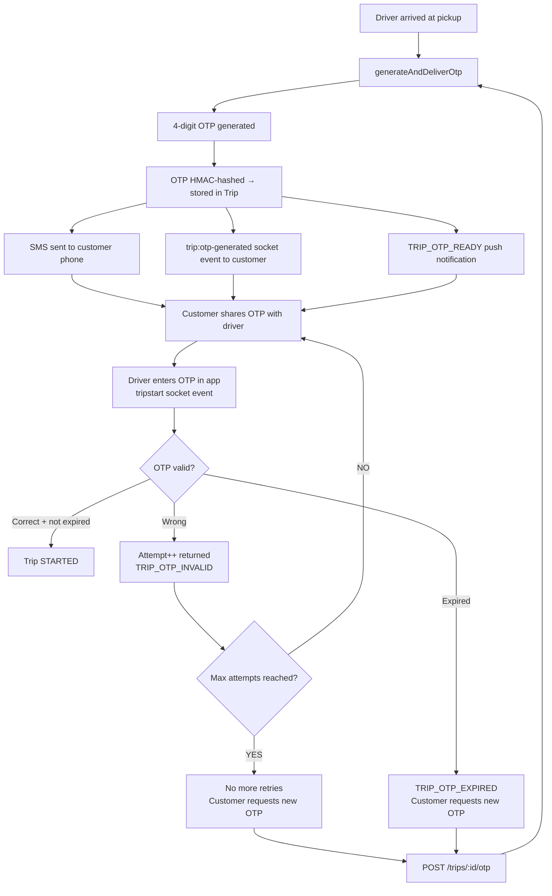

# Sawariya Taxi Booking — Complete Business Flow Documentation (SSOT)

> **Version**: 1.0 | **Date**: 2026-08-19  
> **Scope**: Customer · Driver · Admin · Backend/QA Teams  
> **Source**: Codebase analysis of `/home/fahad/Documents/GitHub/Taxi` (NestJS/Express + Prisma + PostgreSQL + Redis + BullMQ + Socket.IO)

---

## Table of Contents

1. [Architecture Overview](#1-architecture-overview)
2. [All Enumerations & States](#2-all-enumerations--states)
3. [Customer Complete Journey](#3-customer-complete-journey)
4. [Vehicle Selection & Fare Flow](#4-vehicle-selection--fare-flow)
5. [Driver Allocation Flow](#5-driver-allocation-flow)
6. [Trip State Machine](#6-trip-state-machine)
7. [OTP Flow](#7-otp-flow)
8. [Cancellation Scenarios](#8-cancellation-scenarios)
9. [Exception Scenarios & Recovery](#9-exception-scenarios--recovery)
10. [Reschedule Flow](#10-reschedule-flow)
11. [Payment & Refund Flow](#11-payment--refund-flow)
12. [Rating & Review](#12-rating--review)
13. [Driver App Flow](#13-driver-app-flow)
14. [Admin Flow](#14-admin-flow)
15. [API + Socket Responsibility Matrix](#15-api--socket-responsibility-matrix)
16. [Complete Socket Event Catalog](#16-complete-socket-event-catalog)
17. [Database & State Requirements](#17-database--state-requirements)
18. [Notifications Catalog](#18-notifications-catalog)
19. [Flow Diagrams](#19-flow-diagrams)
20. [State Transition Matrix](#20-state-transition-matrix)
21. [Scope & Gap Analysis](#21-scope--gap-analysis)

---

## 1. Architecture Overview

### Technology Stack (Implemented)

| Layer | Technology |
|-------|-----------|
| Runtime | Node.js + TypeScript |
| Framework | Express.js (custom router wiring in `app.ts`) |
| ORM | Prisma (PostgreSQL) |
| Real-time | Socket.IO |
| Queue/Jobs | BullMQ (Redis-backed) |
| Cache/Presence | Redis (ioredis) |
| Payment | Razorpay |
| Push | FCM (Firebase Cloud Messaging) |
| SMS | Custom integration (`sendSmsNotification`, `sendOtp`) |
| Email | Custom SMTP integration |
| Maps | Custom `getRoute()` integration |

### Key Infrastructure Services

```
dispatch queue     → BullMQ queue "dispatch"
notifications queue → BullMQ queue "notifications"
scheduled-rides queue → BullMQ queue "scheduled-rides"
maintenance queue  → BullMQ queue "maintenance"
payments queue     → BullMQ queue "payments"
reports queue      → BullMQ queue "reports"
```

### Socket Room Architecture

```
customer:{customerId}         ← customer personal room
driver:{driverId}             ← driver personal room
booking:{bookingId}           ← both customer + assigned driver joined here
trip:{tripId}                 ← both customer + assigned driver joined here
booking:{bookingId}:chat      ← chat room for this booking
booking:{bookingId}:track     ← tracking room for this booking
category:{categoryId}:drivers ← drivers in a vehicle category (for dispatch)
admin:dashboard               ← admin dashboard events
admin:tracking                ← admin live tracking events
```

---

## 2. All Enumerations & States

### BookingStatus (authoritative state machine)

```
PENDING                 → Booking created, not yet searching
SEARCHING_DRIVER        → Dispatch initiated, looking for driver
DRIVER_ASSIGNED         → Driver accepted the offer
DRIVER_ARRIVING         → Driver started navigating to pickup
DRIVER_ARRIVED          → Driver physically at pickup location
TRIP_STARTED            → OTP verified, trip in progress
TRIP_COMPLETED          → Driver marked trip complete (intermediate)
PAYMENT_PENDING         → Waiting for payment
PAYMENT_COMPLETED       → Payment captured
CANCELLED               → Booking cancelled by any party
NO_DRIVER_FOUND         → Search exhausted, no driver available
```

### TripStatus

```
CREATED         → Trip row created after driver accepts offer
DRIVER_ARRIVING → Driver en route to pickup
DRIVER_ARRIVED  → Driver at pickup location
STARTED         → Trip in progress (after OTP)
COMPLETED       → Trip completed by driver
CANCELLED       → Trip cancelled (linked to booking cancellation)
```

### DriverAvailability (DB)

```
OFFLINE  → Driver not accepting rides
ONLINE   → Driver accepting rides (DB state)
BUSY     → Driver has an active ride
```

### Driver Live Status (Redis only)

```
ONLINE_AVAILABLE → Active in geo index, accepting offers
ONLINE_BUSY      → Has active trip, removed from geo index
PAUSED           → Online but temporarily paused (no offers)
OFFLINE          → No Redis key present
DISCONNECTED     → Detected by presence check (transient)
```

### PaymentStatus

```
CREATED     → Payment row created (before provider order)
PENDING     → Provider order created, waiting for payment
AUTHORIZED  → Payment authorized (some gateways)
CAPTURED    → Payment fully collected
FAILED      → Payment failed
REFUNDED    → Full refund issued
PARTIALLY_REFUNDED → Partial refund issued
CANCELLED   → Payment cancelled before capture
```

### DispatchOfferStatus

```
OFFERED      → Offer sent to driver, awaiting response
ACCEPTED     → Driver accepted
REJECTED     → Driver manually rejected
EXPIRED      → Offer timeout reached
CANCELLED    → Booking cancelled while offer was active
INVALIDATED  → Another driver accepted first (race condition loser)
```

### DispatchCycleStatus

```
ACTIVE    → Current cycle running
COMPLETED → Cycle ended (either driver found or all attempts exhausted)
CANCELLED → Booking cancelled during this cycle
FAILED    → All strategies failed
```

### DriverAssignmentStatus

```
OFFERED   → (legacy/future use)
ACCEPTED  → (legacy/future use)
REJECTED  → (legacy/future use)
TIMED_OUT → (legacy/future use)
ACTIVE    → Driver currently assigned to booking
COMPLETED → Trip completed successfully
RELEASED  → Driver released (cancellation/redispatch)
CANCELLED → Booking cancelled
```

### RefundStatus

```
REQUESTED   → Refund row created
PROCESSING  → Being processed by gateway
COMPLETED   → Refund credited
FAILED      → Refund attempt failed
CANCELLED   → Refund request cancelled
```

### DriverVerificationStatus

```
PENDING       → New submission
UNDER_REVIEW  → Being reviewed by admin
VERIFIED      → Approved and active
REJECTED      → Documents rejected
SUSPENDED     → Temporarily suspended
```

### DriverOnboardingStatus

```
ACCOUNT_CREATED → User account exists, driver profile not started
PROFILE_PENDING → Profile setup incomplete
PROFILE_COMPLETED → Profile filled
KYC_PENDING → Documents not submitted
KYC_UNDER_REVIEW → KYC submitted, in review
KYC_APPROVED → KYC cleared
VEHICLE_PENDING → No vehicle added
VEHICLE_UNDER_REVIEW → Vehicle docs under review
READY_TO_DRIVE → Fully onboarded, can go online
REJECTED → Onboarding rejected
SUSPENDED → Suspended post-onboarding
```

---

## 3. Customer Complete Journey

### Step 1: Registration

| Attribute | Detail |
|-----------|--------|
| Trigger | Customer opens app for the first time |
| API | `POST /auth/customer/send-otp` |
| Input | Phone number |
| Validation | Valid E.164 phone number format |
| Business Rule | OTP is generated (4-digit, HMAC-hashed), stored in `OtpVerification` table with `purpose=LOGIN`, TTL = `OTP_TTL_SECONDS` (env-configured) |
| Max Attempts | 5 (configurable via `maxAttempts` field) |
| DB Change | `OtpVerification` row created; `User` + `CustomerProfile` created on first successful verify |
| Customer-visible | "Enter OTP sent to your phone" |
| Failure | Invalid phone → 400; Rate limited → 429 |

> **[ASSUMPTION]**: No separate "registration" step. Phone OTP serves as both registration and login. On first successful OTP verify, `User` and `CustomerProfile` are auto-created.

### Step 2: OTP Verification / Login

| Attribute | Detail |
|-----------|--------|
| API | `POST /auth/customer/verify-otp` |
| Input | Phone, OTP code |
| Validation | OTP must match hash, not expired, attempts < maxAttempts |
| Business Rule | On success: session created (`Session` table), JWT returned; `phoneVerifiedAt` set if first time |
| DB Change | `OtpVerification.consumedAt` set; `Session` created; `LoginHistory` recorded |
| Failure | Wrong OTP → 401 `TRIP_OTP_INVALID`; Expired → 401 `TRIP_OTP_EXPIRED`; Max attempts → 401 |

### Step 3: Profile Completion

| Attribute | Detail |
|-----------|--------|
| API | `PATCH /customer/profile` |
| Input | displayName, email, gender, dateOfBirth, profileImage |
| Optional | Profile completion is NOT a hard gate for booking (no enforcement seen in code) |
| DB Change | `User.displayName`, `User.email`, `CustomerProfile.*` updated |

> **[ASSUMPTION]**: Profile completion is not a hard prerequisite for booking based on codebase analysis. Recommend enforcing `displayName` at minimum before first booking.

### Step 4: Location Permission

| Attribute | Detail |
|-----------|--------|
| Handled By | Client-side only |
| Backend Impact | Pickup lat/lng coordinates required in booking creation |
| Failure | If no location, booking API returns 400 |

### Step 5–6: Pickup & Drop Location Selection

| Attribute | Detail |
|-----------|--------|
| API | `GET /pricing/estimate` (for fare preview) |
| Input | pickup `{lat, lng}`, drop `{lat, lng}`, vehicleCategoryId, rideType |
| Maps Integration | Backend calls `getRoute()` to calculate `distanceMeters` + `durationSeconds` + `routePolyline` |
| Business Rule | Route is computed server-side using Google Maps/maps integration |

### Step 7: Fare/ETA Estimation

| Attribute | Detail |
|-----------|--------|
| API | `GET /pricing/estimate?pickup=...&drop=...&categoryId=...&rideType=...` |
| Returns | `{ baseFare, distanceCharge, timeCharge, waitingCharge, tollEstimate, surgeMultiplier, surgeCharge, subtotal, discount, tax, estimatedFare, currency }` |
| Estimate Validity | `FareEstimate` row stored with `expiresAt` (TTL-based) |
| Surge | `SurgePricingRule` checked by time window + vehicle category |
| Coupon | Optional: pass `couponCode` to see discounted estimate |

### Step 8: Vehicle/Category Selection

| Attribute | Detail |
|-----------|--------|
| API | `GET /vehicles/categories` |
| Returns | List of active categories with name, image, minPassengers, maxPassengers |
| Availability Check | Client checks available drivers nearby (not a blocking gate at booking time) |

### Step 9: Available Vehicle Information

- Vehicle details shown to customer **only after** driver accepts offer, via `booking:driver-assigned` socket event
- Before acceptance: only category-level info is shown

### Step 10: Booking Confirmation

| Attribute | Detail |
|-----------|--------|
| API | `POST /bookings` (with `x-idempotency-key` header required) |
| Input | `vehicleCategoryId`, `type` (IMMEDIATE/SCHEDULED), `rideType` (CITY/RENTAL/OUTSTATION), `pickup`, `drop`, `scheduledAt?`, `couponCode?`, `customerNote?`, `passengerCount?`, `luggageCount?`, `bookingFor?`, `specialRequirements[]` |
| Idempotency | Enforced via `customerId + idempotencyKey` unique constraint. Same key = same response returned |
| Coupon Validation | Locking `FOR UPDATE` on coupon row to prevent race condition |
| Cancellation Fee Recovery | Any outstanding `BookingCancellation.fee` (unpaid from previous cancelled bookings) is added to the new booking's `estimatedFare` |
| DB Change | `Booking` created (status=PENDING); `FareBreakdown` (kind=ESTIMATE) created; `ScheduledBooking` created if SCHEDULED; `CouponUsage` created if coupon used |
| Socket Emit | `booking:created` → booking room; `admin:booking:created` → admin dashboard |
| Next Action | If IMMEDIATE → dispatch job enqueued immediately; If SCHEDULED → `scheduled-activate` + `scheduled-reminder` jobs enqueued with delay |
| Validations | Customer account ACTIVE; Category active; Route computable; Coupon valid (if provided); Scheduled time ≥ +15 minutes from now |

### Step 11: Driver Searching

| Attribute | Detail |
|-----------|--------|
| Trigger | `dispatch.start()` called by BullMQ worker |
| State Change | `PENDING → SEARCHING_DRIVER` |
| Socket Emit | `booking:searching-driver` → booking room |
| Timeout | 8 minutes (`dispatch-search-timeout` job) → if no driver found → `NO_DRIVER_FOUND` |
| Strategy | 3-attempt progressive radius expansion (2km, 4km, 10km) |

### Step 12–13: Driver Allocation & Acceptance

See [Section 5: Driver Allocation Flow](#5-driver-allocation-flow) for full detail.

| State Changes |
|---|
| `SEARCHING_DRIVER → DRIVER_ASSIGNED` (Booking) |
| `CREATED` (Trip created simultaneously) |

### Step 14: Driver Reaching Pickup

| Attribute | Detail |
|-----------|--------|
| Trigger | Driver taps "Head to Pickup" in app |
| Socket Event | `driver:heading-to-pickup` → `trips.arriving()` |
| API | `PATCH /trips/:id/arriving` |
| State Change | `DRIVER_ASSIGNED → DRIVER_ARRIVING` (Booking); `CREATED → DRIVER_ARRIVING` (Trip) |
| Socket Emit | `driver:heading-to-pickup` → booking room |
| ETA | Client-side calculation based on driver location updates |

### Step 15: Customer-Driver Communication (Chat)

| Attribute | Detail |
|-----------|--------|
| Socket Events | `chat:send`, `chat:join` |
| DB | `ChatMessage` table, per-booking chat history |
| Access Control | Only booking customer + assigned driver can chat |
| Rate Limit | 30 messages per minute per user |

### Step 16: Driver Arrived at Pickup

| Attribute | Detail |
|-----------|--------|
| Trigger | Driver taps "I've Arrived" in app |
| Socket Event | `driver:arrived` → `trips.arrived()` |
| API | `PATCH /trips/:id/arrived` |
| Prerequisite | Driver must be within `PICKUP_RADIUS_METERS` of pickup location (env-configured) |
| State Change | `DRIVER_ARRIVING → DRIVER_ARRIVED` (Booking); `DRIVER_ARRIVING → DRIVER_ARRIVED` (Trip) |
| OTP Generated | `generateAndDeliverOtp()` called automatically on arrival |
| Socket Emit | `driver:arrived` → booking room |
| Waiting Job | `pickup-waiting-check` job enqueued (5 min delay) |

### Step 17: Trip-Start OTP Generation/Verification

See [Section 7: OTP Flow](#7-otp-flow) for complete detail.

| Attribute | Detail |
|-----------|--------|
| OTP Format | 4-digit numeric (production); fixed code in test/dev |
| Delivery | SMS to customer's phone + `trip:otp-generated` socket event to customer |
| Validity | `OTP_TTL_SECONDS` (env-configured) |
| Verification | Driver enters OTP in app → `trip:start` socket event or `POST /trips/:id/start` API |

### Step 18: Trip Started

| Attribute | Detail |
|-----------|--------|
| Trigger | OTP verified by driver |
| State Change | `DRIVER_ARRIVED → TRIP_STARTED` (Booking); `DRIVER_ARRIVED → STARTED` (Trip) |
| Socket Emit | `trip:started` → booking room + driver |
| Location Tracking | Live location updates begin via `driver:location:update` socket |
| Stale Check | `trip-tracking-stale-check` job enqueued to detect GPS failures |

### Step 19: Live Trip Tracking

| Attribute | Detail |
|-----------|--------|
| Socket Event | `driver:location:update` → triggers `emitRideLocation()` |
| Buffer | Location points stored in Redis buffer (`tracking:persist-buffer`) |
| Persist | `persist-locations` job runs every 30s, writes to `DriverLocation` + `TripLocationHistory` |
| Customer View | `booking:{bookingId}:track` room receives `trip:location-updated` events |
| Admin View | `admin:tracking` room receives `admin:trip:location-updated` events (throttled 3s) |

### Step 20: Destination Reached + Trip Completion

| Attribute | Detail |
|-----------|--------|
| Trigger | Driver taps "Complete Trip" |
| Socket Event | `trip:complete` → `trips.complete()` |
| API | `PATCH /trips/:id/complete` |
| Prerequisite | Driver must be within `TRIP_COMPLETION_RADIUS_METERS` of drop location (env-configured) |
| Distance Calc | Actual distance calculated from `TripLocationHistory` GPS points (SAMPLED_TRACKING); falls back to `BOOKED_ROUTE_FALLBACK` if < 2 points |
| State Change | `TRIP_STARTED → TRIP_COMPLETED → PAYMENT_PENDING` (Booking); `STARTED → COMPLETED` (Trip) |
| Final Fare | Recalculated based on actual distance/duration + any cancellation dues |
| DB Change | `FareBreakdown` (kind=FINAL) created; `DriverEarning` created; Driver availability restored to ONLINE |

### Step 21: Final Fare Calculation

```
Final Fare = baseFare + distanceCharge + timeCharge + waitingCharge + tollCharge + surgeCharge - discount + tax + cancellationDue
```

All amounts in INR (or booking currency). `FareBreakdown.total` = amount due from customer.

### Step 22: Payment

See [Section 11: Payment & Refund Flow](#11-payment--refund-flow).

| Methods | Details |
|---------|---------|
| CASH | Driver confirms receipt; immediate `CAPTURED` |
| WALLET | Customer wallet debit; immediate `CAPTURED` |
| UPI/Card/NetBanking | Razorpay order created; customer pays in-app; webhook/verify confirms |

### Step 23: Invoice/Receipt

| Attribute | Detail |
|-----------|--------|
| Generated By | `invoice-generation` BullMQ job after trip completion |
| Also | Created inline in `markPaid()` transaction when `FareBreakdown` exists |
| DB Model | `Invoice` with `invoiceNumber`, `subtotal`, `tax`, `total`, `fileKey` |
| Invoice Number | Format: `INV-{tripId-stripped}-` or `INV-{timestamp}-{bookingId-prefix}` |

### Step 24: Rating & Review

See [Section 12: Rating & Review](#12-rating--review).

| Attribute | Detail |
|-----------|--------|
| Trigger | `booking:show-rating` socket event emitted after payment captured |
| Window | Only `COMPLETED` trips can be rated |
| Both-way | Customer rates driver; driver rates customer |

### Step 25: Booking/Trip History

| API | `GET /bookings?page=1&limit=20` |
|-----|-------------------------------|
| Filter | Customer sees own bookings; Driver sees bookings where they had ACCEPTED offer |
| Includes | Status, fare, pickup/drop, timestamps |

---

## 4. Vehicle Selection & Fare Flow

### Vehicle Categories

Managed by Admin via `VehicleCategory` model:
- `slug`, `name`, `description`, `imageUrl`, `iconUrl`
- `minPassengers`, `maxPassengers`
- `allowedFuelTypes[]`
- `isActive`, `displayOrder`

### Fare Calculation Formula

```
1. baseFare (from PricingRule)
2. distanceCharge = (distanceMeters / 1000) × perKilometer
3. timeCharge = (durationSeconds / 60) × perMinute
4. waitingCharge = waitingMinutes × waitingPerMinute
5. tollCharge = actual toll (driver-reported, 0 at estimate time)
6. beforeSurge = baseFare + distanceCharge + timeCharge + waitingCharge
7. surgeMultiplier = from SurgePricingRule (time-window based), default = 1
8. surgeCharge = beforeSurge × (surgeMultiplier - 1)
9. subtotal = beforeSurge + surgeCharge + tollCharge
10. IF subtotal < minimumFare → subtotal = minimumFare
11. discount = coupon discount (FIXED or PERCENTAGE, max capped)
12. taxable = subtotal - discount
13. tax = taxable × (taxPercentage / 100)
14. total = taxable + tax [rounded to 2 decimal places]
15. platformCommission = taxable × (platformCommission% / 100) [driver-side deduction]
16. cancellationDue = any outstanding cancellation fees → added to booking total
```

### Pricing Rule Fields (PricingRule model)

| Field | Description |
|-------|-------------|
| `vehicleCategoryId` | Applies to this category |
| `rideType` | CITY / RENTAL / OUTSTATION |
| `baseFare` | Fixed base fare |
| `perKilometer` | Per-km rate |
| `perMinute` | Per-minute rate |
| `minimumFare` | Minimum chargeable fare |
| `waitingPerMinute` | Waiting charges rate |
| `cancellationFee` | Fee applied on cancellation (after free cancels) |
| `driverAllowance` | Daily driver allowance (outstation) |
| `platformCommission` | Platform % commission |
| `nightCharge` | Night surcharge (schema defined, **not yet implemented in service**) |
| `taxPercentage` | GST/tax % |
| `scopeKey` | "GLOBAL" or zone-scoped key |
| `effectiveFrom/To` | Pricing rule validity window |
| `version` | Versioning for rule updates |

> **[AMBIGUITY]**: `nightCharge` is defined in the schema but the `PricingService.calculate()` does **NOT** apply it. **Recommended**: Implement night charge as a time-window-based addition or create a separate `SurgePricingRule` entry for night hours.

### Fare Recalculation Conditions

1. **At trip completion**: Final fare is always recalculated from actual GPS distance/duration
2. **Estimate → Final**: `FareBreakdown` of kind `ESTIMATE` created at booking; kind `FINAL` created at completion
3. **Coupon**: Applied only at estimate and booking creation. NOT re-applied at final fare calculation (discount carried in snapshot)
4. **Surge**: Checked fresh at both estimate AND completion time

### Minimum Fare

Enforced in `PricingService.calculate()`: `if subtotal < minimumFare → subtotal = minimumFare`

### Waiting Charges

- `waitingPerMinute` defined in pricing rule
- `waitingMinutes` calculated automatically from `(startedAt - arrivedAt) / 60` and applied during `trips.complete()`

### Cancellation Charges

- After **2 free cancellations**, `cancellationFee` from `PricingRule` is applied
- Fee tracked in `BookingCancellation.fee`
- Outstanding fees added to **next booking** at creation time
- Admin cancellations never incur fees

### Rental/Outstation Pricing

- `RentalPackage`: hours, distanceKm, basePrice, extraKmRate, extraHourRate
- `OutstationPricing`: roundTripPerKm, oneWayPerKm, driverAllowancePerDay
- > **[GAP]**: Rental/Outstation pricing rows exist in DB but `PricingService.calculate()` does NOT use them — it only reads `PricingRule`. **Recommended**: Add ride-type-specific pricing logic branches.

---

## 5. Driver Allocation Flow

### Dispatch Strategy (Implemented)

```typescript
const strategy = [
  { radiusMeters: 2_000, batchSize: 3, timeoutSeconds: 60 },  // Attempt 1
  { radiusMeters: 4_000, batchSize: 5, timeoutSeconds: 60 },  // Attempt 2
  { radiusMeters: 10_000, batchSize: 8, timeoutSeconds: 60 }, // Attempt 3
]
```

### Complete Allocation Lifecycle

```
BOOKING_CREATED (PENDING)
       ↓
DISPATCH JOB ENQUEUED
       ↓
dispatch.start() → PENDING → SEARCHING_DRIVER
       ↓
processDispatchCycle()
       ↓
[DispatchCycle created] → Attempt 1: 2km radius, batch of 3 drivers
       ↓
getEligibleDrivers() → Redis GEOSEARCH + freshness + DB eligibility check
       ↓
If drivers found → DispatchOffer rows created → Socket + Push sent to drivers
       ↓ (wait up to 60 seconds)
       ↓
Driver accepts → acceptRide() → SEARCHING_DRIVER → DRIVER_ASSIGNED
Driver rejects → rejectRide() → If no offers remain → next batch
All offers timeout → expireAttempt() → Attempt 2 (4km, 5 drivers)
No drivers in 2km → wait 15s → retry same attempt
All 3 attempts exhausted → NO_DRIVER_FOUND
Global 8-min timeout → NO_DRIVER_FOUND
```

### Driver Selection Criteria

The `getEligibleDrivers()` method applies:

1. **Redis GEO Search**: Drivers in geo-index for the category within radius
2. **Freshness Check**: Must have active `presence`, `location`, and `availability` Redis keys
3. **Live Status**: `availability.status === "ONLINE_AVAILABLE"` AND `categoryId === booking.vehicleCategoryId`
4. **DB Validation**:
   - `verificationStatus === VERIFIED`
   - `availability === ONLINE`
   - `user.status === ACTIVE`
   - No expired/unverified driver documents
   - No active booking in any of: DRIVER_ASSIGNED/ARRIVING/ARRIVED/TRIP_STARTED
   - No active unexpired dispatch offer from another booking
   - Active vehicle assignment with ACTIVE+APPROVED vehicle of correct category
   - No expired/unverified vehicle documents
5. **Exclusion**: Already-offered drivers in this booking's history excluded
6. **Scoring** (composite):
   - Proximity: 35% + 20% (proximity counted twice — minor bug but intentional weighting)
   - Idle time: 15%
   - Location freshness: 10%
   - Rating: 8%
   - Operational history (neutral): 5% + 5% + 2%

### Sequential vs Parallel

- **Parallel within a batch**: All drivers in a batch receive the offer simultaneously
- **Sequential between batches**: Next batch only starts after current batch expires/all reject

### Request Timeout per Offer

- 60 seconds per batch attempt
- Redis TTL set on each offer key with 60s + grace period (`OFFER_GRACE_SECONDS = 60`)

### Driver Rejection Handling

1. Driver rejects → offer marked `REJECTED`
2. If **all offers in a batch are rejected/expired** → `dispatch-next-batch` job enqueued
3. System moves to next attempt

### Allocation Failure (No Driver)

- After all 3 attempts fail → `NO_DRIVER_FOUND` booking status
- Global 8-minute timeout also triggers `NO_DRIVER_FOUND`
- Customer notified via socket `dispatch:no-driver-found`

### Driver Acceptance (Race Condition Handling)

- Redis distributed lock (`lock:booking:{bookingId}:state`, 10s TTL) prevents double-acceptance
- Serializable Postgres transaction used inside lock
- If lock lost: `winningReplayOrThrow()` checks if caller already won
- Losing drivers receive `dispatch:offer-cancelled` with reason `OFFER_TAKEN`

### Reallocation / Redispatch

Triggered by:
1. Driver cancels after acceptance (`dispatch.driverCancel()`)
2. Assigned driver disconnects for > `ASSIGNED_DRIVER_DISCONNECT_GRACE_SECONDS`

```
driverCancel/disconnect detected
       ↓
redispatchForDriver()
  - Booking: DRIVER_ASSIGNED/ARRIVING/ARRIVED → SEARCHING_DRIVER
  - DriverAssignment: ACTIVE → RELEASED
  - Trip: CREATED/DRIVER_ARRIVING/DRIVER_ARRIVED → CANCELLED (new trip will be created on next acceptance)
  - Driver availability: set to OFFLINE (penalty)
  - Vehicle: isAvailable = true
       ↓
New dispatch job enqueued (dispatch-start)
  - Customer gets `booking:driver-reassigned` event
  - Driver gets `booking:cancelled` event
```

> **[BUSINESS RULE]**: After driver cancellation, driver is set to `OFFLINE` (not just `ONLINE`) as a penalty measure. Driver must manually go online again.

---

## 6. Trip State Machine

### Booking State Machine

```
                     ┌─────────────────────┐
                     │       PENDING        │
                     └─────────┬───────────┘
                              │ dispatch.start()
                     ┌────────▼────────────┐
             ┌──────►│  SEARCHING_DRIVER   │◄──────────┐ (redispatch)
             │        └────────┬────────────┘           │
             │                 │ driver accepts          │
             │        ┌────────▼────────────┐           │
             │        │   DRIVER_ASSIGNED   │───────────┘ driver cancels
             │        └────────┬────────────┘
             │                 │ driver:heading-to-pickup
             │        ┌────────▼────────────┐
             │        │   DRIVER_ARRIVING   │───────────┐ driver cancels
             │        └────────┬────────────┘           │
             │                 │ driver:arrived          │
             │        ┌────────▼────────────┐           │
             │        │   DRIVER_ARRIVED    │───────────┘
             │        └────────┬────────────┘
             │                 │ trip:start (OTP verified)
             │        ┌────────▼────────────┐
             │        │    TRIP_STARTED      │ [CANCELLED not allowed here]
             │        └────────┬────────────┘
             │                 │ trip:complete
             │        ┌────────▼────────────┐
             │        │   TRIP_COMPLETED     │ [intermediate, instant]
             │        └────────┬────────────┘
             │                 │ auto-transition
             │        ┌────────▼────────────┐
             │        │   PAYMENT_PENDING    │
             │        └────────┬────────────┘
             │                 │ payment captured
             │        ┌────────▼────────────┐
             │        │  PAYMENT_COMPLETED   │ [terminal]
             │        └─────────────────────┘
             │
CANCELLED (allowed from: PENDING, SEARCHING_DRIVER, DRIVER_ASSIGNED, DRIVER_ARRIVING, DRIVER_ARRIVED)
NO_DRIVER_FOUND (from: SEARCHING_DRIVER)
```

### Trip State Machine

```
CREATED → DRIVER_ARRIVING → DRIVER_ARRIVED → STARTED → COMPLETED
                                            ↓                ↓
                                        CANCELLED       CANCELLED (not applicable - STARTED is one-way)
```

### Who Triggers Each Transition

| Booking Transition | Triggered By | Method |
|-------------------|-------------|--------|
| PENDING → SEARCHING_DRIVER | BullMQ Worker (dispatch job) | `dispatch.start()` |
| SEARCHING_DRIVER → DRIVER_ASSIGNED | Driver (via socket accept) | `dispatch.accept()` |
| DRIVER_ASSIGNED → DRIVER_ARRIVING | Driver (socket event) | `trips.arriving()` |
| DRIVER_ARRIVING → DRIVER_ARRIVED | Driver (socket event) | `trips.arrived()` |
| DRIVER_ARRIVED → TRIP_STARTED | Driver (OTP via socket) | `trips.start()` |
| TRIP_STARTED → TRIP_COMPLETED | Driver (socket event) | `trips.complete()` |
| TRIP_COMPLETED → PAYMENT_PENDING | System (auto in same transaction) | `trips.complete()` |
| PAYMENT_PENDING → PAYMENT_COMPLETED | Payment gateway / driver / customer | `payments.create()` or webhook |
| Any → CANCELLED | Customer / Driver / Admin / System | `bookings.cancel()` or `dispatch.driverCancel()` |
| SEARCHING_DRIVER → NO_DRIVER_FOUND | BullMQ Worker (timeout) | `dispatch.handleBookingTimeout()` |
| DRIVER_ASSIGNED/ARRIVING/ARRIVED → SEARCHING_DRIVER | Driver / System (disconnect) | `dispatch.redispatchForDriver()` |

### Invalid Transitions (Must be Rejected)

| Invalid Transition | Error |
|-------------------|-------|
| TRIP_STARTED → CANCELLED | `INVALID_BOOKING_TRANSITION` (not in transition map) |
| PAYMENT_PENDING → CANCELLED | `INVALID_BOOKING_TRANSITION` |
| PAYMENT_COMPLETED → * | `INVALID_BOOKING_TRANSITION` |
| CANCELLED → * | `INVALID_BOOKING_TRANSITION` |
| NO_DRIVER_FOUND → * | `INVALID_BOOKING_TRANSITION` |
| DRIVER_ARRIVED → DRIVER_ARRIVING | `INVALID_BOOKING_TRANSITION` |

---

## 7. OTP Flow

### When OTP is Generated

1. **Automatically** when driver calls `trips.arrived()` (driver arrives at pickup)
2. **On customer request**: `POST /trips/:id/otp` (re-generation, requires `DRIVER_ARRIVED` status)
3. **On driver request**: `POST /trips/:id/otp/driver` (driver can request OTP re-generation)

### Who Receives OTP

- **Customer**: Via SMS (`sendOtp()` to `trip.booking.customer.user.phone`)
- **Customer**: Via socket event `trip:otp-generated` (to `user:{customerId}` room)
- **Customer**: Via Push notification (`TRIP_OTP_READY` template)

> **[BUSINESS RULE]**: OTP is delivered to the **customer**, not the driver. The **driver** must ask the customer verbally for the OTP and enter it in the driver app.

### OTP Format

- **Production**: 4-digit random integer (`randomInt(1_000, 10_000)`)
- **Dev/Test**: Fixed code from `OTP_FIXED_CODE` env variable
- **Storage**: HMAC-SHA256 hash (`createHmac("sha256", COOKIE_SECRET).update("{tripId}:{otp}")`)

### OTP Validity Period

- `OTP_TTL_SECONDS` (env-configured, recommended 5-10 minutes)
- Stored in `Trip.verificationOtpExpiresAt`

### OTP Verification

| Method | Detail |
|--------|--------|
| Socket | `trip:start` event with `{ tripId, otp }` → `trips.start()` |
| REST API | `POST /trips/:id/start` with OTP in body |
| Alternative (2-step) | `POST /trips/:id/verify-otp` → then `POST /trips/:id/start-verified` (OTP checked separately, then trip starts) |

### Incorrect OTP Handling

- `Trip.otpAttempts` incremented on each wrong attempt
- If `otpAttempts >= OTP_MAX_ATTEMPTS` (env-configured) → error `TRIP_OTP_INVALID` (no more attempts)
- Error returned: `TRIP_OTP_INVALID` (409 Conflict)

### Expired OTP Handling

- If `verificationOtpExpiresAt <= now` → error `TRIP_OTP_EXPIRED` (401 Unauthorized)
- Customer must request new OTP via `POST /trips/:id/otp`
- New OTP resets `otpAttempts` to 0

### OTP Regeneration

- Customer can call `POST /trips/:id/otp` only when trip status is `DRIVER_ARRIVED`
- Generates new OTP, overwrites old hash and expiry, resets `otpAttempts`

### Redis Lock During Verification

- `trip:pickup-otp-lock:{tripId}` (10s TTL) prevents concurrent OTP verification attempts

### Can Trip Start Without OTP?

- **No**. The `trips.start()` method requires valid OTP.
- The `trips.startVerified()` method (2-step flow) requires an `AuditLog` entry `PICKUP_OTP_VERIFIED` for the driver.
- Bypassing OTP is not possible in production. Admin can use emergency cancellation but cannot force-start without OTP.

---

## 8. Cancellation Scenarios

### Customer Cancellation

#### Before Driver Allocation (PENDING / SEARCHING_DRIVER)

| Rule | Detail |
|------|--------|
| Allowed | Yes |
| Cancellation Fee | First 2 cancellations: **FREE**. 3rd+: `PricingRule.cancellationFee` |
| Refund | If payment was captured (not applicable at this stage) |
| Driver Notification | Any offered drivers get `dispatch:offer-cancelled` socket event |
| Booking State | `CANCELLED` |
| Payment State | No payment at this stage |

#### After Driver Allocation (DRIVER_ASSIGNED / DRIVER_ARRIVING / DRIVER_ARRIVED)

| Rule | Detail |
|------|--------|
| Allowed | Yes |
| Cancellation Fee | First 2 cancellations: FREE; 3rd+: `cancellationFee` from pricing rule |
| Fee Recovery | Fee added to **next** booking's fare |
| Refund | If online payment was captured: refund = `amountPaid - cancellationFee` (via `Refund` row) |
| Driver Release | Driver set back to ONLINE; Vehicle set to isAvailable=true |
| Driver Notification | `booking:cancelled` socket event to driver |
| Trip Status | If trip exists in CREATED/DRIVER_ARRIVING/DRIVER_ARRIVED → `CANCELLED` |
| Booking State | `CANCELLED` |

#### During Trip (TRIP_STARTED)

| Rule | Detail |
|------|--------|
| Allowed | **NO** — `TRIP_STARTED` is NOT in the allowed cancellation transitions |
| Error | `INVALID_BOOKING_TRANSITION` |

> **[BUSINESS RULE]**: Customer **cannot** cancel once trip has started. Admin emergency cancellation may be needed via direct DB/admin panel action.

### Driver Cancellation

#### Before/During Navigation (DRIVER_ASSIGNED / DRIVER_ARRIVING / DRIVER_ARRIVED)

| Rule | Detail |
|------|--------|
| API/Socket | `booking:cancel` socket event OR `POST /dispatch/:bookingId/driver-cancel` |
| Triggers | `dispatch.driverCancel()` → `redispatchForDriver()` |
| Booking State | `DRIVER_ASSIGNED/ARRIVING/ARRIVED → SEARCHING_DRIVER` (re-dispatch) |
| Driver Penalty | Driver set to `OFFLINE` (must manually go online) + `markTemporarilyUnavailable()` |
| Customer Effect | `booking:driver-reassigned` socket event; new driver search begins |
| Cancellation Fee to Driver | Currently NOT implemented. **[GAP]** |

#### During Trip (TRIP_STARTED)

| Rule | Detail |
|------|--------|
| Allowed | **NOT in codebase** — no `driverCancel` allowed when booking is `TRIP_STARTED` |
| Code Check | `redispatchForDriver()` checks: `["DRIVER_ASSIGNED", "DRIVER_ARRIVING", "DRIVER_ARRIVED"].includes(status)` |
| If Trip Started | Returns `INVALID_BOOKING_TRANSITION` error |

> **[AMBIGUITY]**: What happens if driver reports an emergency mid-trip? Currently not handled. **Recommended**: Admin emergency cancellation workflow or SOS flow that can force-complete/cancel trip.

### Admin Cancellation

| Rule | Detail |
|------|--------|
| Allowed Stages | Any stage where `canTransition(status, CANCELLED)` is true |
| Fee | Admin cancellations incur 0 fee (`isAdmin` check → `fee = 0`) |
| Refund | Full refund if payment was captured |
| Implementation | `bookings.cancel()` with admin roles |

---

## 9. Exception Scenarios & Recovery

### Driver Rejection

- Offer marked `REJECTED` in `DispatchOffer`
- If all offers in batch rejected → `dispatch-next-batch` job → process next batch
- Driver who rejected: no penalty, can receive future offers

### Driver Timeout (Offer Expires)

- `dispatch-offer-timeout` job fires after `timeoutSeconds`
- `expireAttempt()` called → offers marked `EXPIRED`
- Socket `dispatch:offer-expired` sent to expired drivers
- System calls `processDispatchCycle()` for next batch

### No Available Driver

- After 3 attempts across progressively larger radii OR 8-minute global timeout
- Booking → `NO_DRIVER_FOUND`
- Customer notified via `dispatch:no-driver-found` socket event
- Customer can re-book (creates new booking)

### Customer No-Show

- `pickup-waiting-check` job runs 5 min after driver arrives
- The `pickup-waiting-check` handler in `workers.ts` notifies the customer with a `PICKUP_WAITING_WARNING` push notification and emits a `trip:issue-reported` event.

### Driver No-Show

- If driver never sends `driver:heading-to-pickup` after assignment
- The `driver-no-show-check` job runs 5 minutes after acceptance. If the status is still `DRIVER_ASSIGNED`, the booking is redispatched to find a new driver.

### Customer/Driver Unreachable

- Handled via chat feature (in-app messaging)
- SOS system can be triggered: `sos:create` socket event
- No automated "unreachable" detection

### Wrong OTP

- Error: `TRIP_OTP_INVALID`
- Attempt counter incremented
- Customer re-generates OTP if needed

### OTP Expiry

- Error: `TRIP_OTP_EXPIRED` (401)
- Customer must call `POST /trips/:id/otp` to get new one

### Payment Failure

- Payment gateway returns error → `Payment.status = FAILED`
- `admin:payment:failed` emitted to admin dashboard
- Customer must retry (new `POST /payments` with new idempotency key)
- Booking stays `PAYMENT_PENDING`

### Duplicate Payment Prevention

- `Payment.idempotencyKey` is unique constraint
- Same `idempotencyKey` → same payment record returned
- Razorpay webhook `providerEventId` stored as unique key in `PaymentTransaction`

### Payment Timeout/Reconciliation

- Stale payments (CREATED/PENDING/AUTHORIZED, >15 minutes old) reconciled via `payments reconcile` job (runs every 15 min)
- Razorpay `getOrderPayments()` called; if captured → `capture()` called

### Refund Flow

- `Refund` row created on booking cancellation with a captured payment
- `idempotencyKey = "booking-cancel:{bookingId}"`
- A `process-refund` job is enqueued to the `payments` queue.
- The `PaymentsService.processRefund()` method calls the Razorpay API to process the refund and updates the `Refund` status to `COMPLETED` (or `FAILED` if there's an error).

### Trip Interrupted / Driver App Disconnect

1. Driver socket disconnects → `disconnect` event handler fires
2. `scheduleDisconnectCheck()` called → `driver-presence-stale-check` job with `DRIVER_DISCONNECT_GRACE_SECONDS` delay
3. If still disconnected after grace period:
   - If no active ride → driver goes `OFFLINE`
   - If active ride (DRIVER_ASSIGNED/ARRIVING/ARRIVED) → `redispatchForDriver()` (re-search)
   - If trip STARTED → `checkTripTracking()` scheduled, customer notified via `trip:issue-reported`

### Socket Reconnect

- On reconnect, driver/customer should send `state:sync:request` event
- `SocketStateSyncService.synchronize()` returns current booking/trip state
- Socket rooms re-joined based on active bookings

### Duplicate Socket Events

- State transitions use Postgres `updateMany` with WHERE clause on current status + version → idempotent
- Redis distributed locks prevent race conditions
- Retry-safe: most transitions check "already in target state" and return without error

### Concurrent Cancellation/Acceptance

- `lock:booking:{bookingId}:state` Redis key (10s) used for both accept and cancel
- If both happen simultaneously: first to acquire lock wins, second gets `BOOKING_STATE_CHANGED` or `OFFER_TAKEN` error

### Server Failure During Booking/Trip

- `recoverPendingBookings()` maintenance job (every 60s) re-dispatches PENDING/SEARCHING_DRIVER bookings
- `reconcileRealtimeState()` job (every 60s) fixes driver availability inconsistencies
- `reconcileStaleDrivers()` job (every 60s) force-offlines drivers with no location data

---

## 10. Reschedule Flow

### Is Rescheduling Supported?

**Partially implemented in schema; NOT in API/service layer.**

Evidence:
- `ScheduledBooking.rescheduleCount` field exists
- `ScheduledBooking.lastRescheduledAt` field exists
- `ScheduledBooking.version` field exists (used for stale job prevention)
- `ScheduledBooking.recoveryCount` exists

However, no `reschedule` API endpoint or service method found.

### Current Scheduled Booking Behavior

1. Booking created with `type=SCHEDULED` and `scheduledAt`
2. Two jobs enqueued:
   - `scheduled-reminder` fires 30 minutes before `scheduledAt`
   - `scheduled-activate` fires 10 minutes before `scheduledAt` → triggers dispatch
3. Version checking prevents stale jobs from double-firing

### Recommended Reschedule Implementation

| Rule | Recommended Business Rule |
|------|--------------------------|
| Who can reschedule | Customer only |
| Allowed stages | Only when booking is `PENDING` and `type=SCHEDULED` |
| Time restriction | New `scheduledAt` must be ≥ 15 minutes from now |
| Action | Cancel old jobs, enqueue new versioned jobs, increment `rescheduleCount` |
| Fare recalculation | Re-run pricing with same pickup/drop |
| Driver reallocation | Not applicable (dispatch not started yet) |
| Cancellation/reschedule charges | Up to business: currently 0 |
| Max reschedules | Recommended: 3 per booking |

> **[OUT OF SCOPE UNTIL EXPLICITLY REQUIRED]**: Live trip rescheduling (mid-trip) is completely out of scope.

---

## 11. Payment & Refund Flow

### Payment Lifecycle

```
Trip completed → PAYMENT_PENDING booking status
       ↓
Customer initiates payment (POST /payments with idempotency key)
       ↓
CASH? → CAPTURED immediately (driver confirms cash receipt)
WALLET? → Balance checked → Debit → CAPTURED immediately
ONLINE (UPI/Card)? → Razorpay Order created → PENDING
       ↓
Customer pays in app (Razorpay SDK)
       ↓
Client calls POST /payments/:id/verify with signature → CAPTURED
OR
Razorpay webhook fires → payment.captured event → CAPTURED
       ↓
PAYMENT_PENDING → PAYMENT_COMPLETED (booking)
       ↓
Invoice created (upsert)
Driver earning credited to DriverWallet (online payments only)
booking:show-rating event emitted
earnings:credited event to driver
```

### Payment Permission Rules

| Method | Who Can Initiate |
|--------|-----------------|
| CASH | Assigned driver or Admin only |
| WALLET | Customer only |
| UPI/Card/NetBanking | Customer or Admin |

### Webhook Handling

- Endpoint: `POST /webhook/razorpay` (or similar)
- Signature verified: `razorpay.verifyWebhook(rawBody, signature)`
- Idempotency: `PaymentTransaction.providerEventId` checked for duplicates before processing
- Only `payment.captured` event is handled (other events ignored)

### Refund Eligibility

- Refund created when booking is cancelled AND a captured payment exists
- Amount = `amountPaid - cancellationFee` (minimum 0)

### Refund Status Tracking

```
REQUESTED → (processing) → COMPLETED / FAILED / CANCELLED
```

> **Note**: Refunds are processed asynchronously via the `process-refund` BullMQ job in the `payments` worker, which calls the Razorpay API.

### Cash Payment — Driver Earnings

- For CASH payments, driver `DriverEarning.cashCollected` should be set (currently set to 0 in DB creation — **[GAP]**)
- Driver wallet credit only happens for **online** payments
- For cash: `DriverEarning.status = PENDING_SETTLEMENT` (driver retains cash physically)

---

## 12. Rating & Review

### Who Can Rate Whom

| Actor | Can Rate | Subject Type |
|-------|----------|-------------|
| Customer | Driver | `DRIVER` |
| Driver | Customer | `CUSTOMER` |
| Admin | Neither (view only) | — |

### Rating Eligibility

- Trip must have `status = COMPLETED`
- Only the trip's actual customer and driver can rate
- Relationship validated: customer↔driver must match the trip participants

### Rating Window

- **[GAP]**: No time window enforcement in code. Ratings can technically be submitted any time after trip completion.
- **Recommended**: Add 72-hour rating window after `completedAt`

### Duplicate Rating Prevention

- `Rating.unique([tripId, authorUserId])` constraint
- One rating per person per trip

### Rating Scale

- `Rating.score` (integer) — no min/max enforced in service code
- **Recommended**: Validate `score` as 1–5

### Review Rules

- Optional `comment` field creates a `Review` row linked to `Rating`
- `Review.isHidden` flag for admin moderation

### Driver Rating Impact

- On every `DRIVER` rating submitted → aggregate `AVG(score)` recalculated and updated in `DriverProfile.averageRating`
- Customer rating: stored but `CustomerProfile` has no `averageRating` field

### Rating Prompt to Customer

- `booking:show-rating` socket event emitted after payment captured
- Prompt shown by client app; optional for customer to complete

---

## 13. Driver App Flow

### Driver Onboarding

```
Account Created (ACCOUNT_CREATED)
       ↓
Profile filled (PROFILE_COMPLETED)
       ↓
KYC documents submitted (KYC_UNDER_REVIEW)
       ↓
Admin reviews & approves (KYC_APPROVED)
       ↓
Vehicle added + documents submitted (VEHICLE_UNDER_REVIEW)
       ↓
Admin approves vehicle (READY_TO_DRIVE)
       ↓
Driver can go ONLINE
```

### Driver Session / Login

- OTP-based login (same mechanism as customer, different `purpose` field)
- JWT session returned on successful verify

### Going Online (Socket)

| Event | `driver:online` or `driver:go-online` |
|-------|---------------------------------------|
| Prerequisite | Valid location payload required |
| Checks | `checkEligibility()`: verificationStatus=VERIFIED, availability≠BUSY, active vehicle assignment, no expired docs |
| Action | DB: `availability = ONLINE`; Redis: geo-add, availability key, presence key |
| Emit | `driver:availability-updated` to driver + admin |

### Receiving Booking Offer

| Event (Received) | `dispatch:offer` |
|------------------|-----------------|
| Payload | `{ offerId, bookingId, dispatchCycleId, pickup, drop, estimatedFare, distanceMeters, durationSeconds, estimatedDriverEarning, expiresAt }` |
| Also | Push notification sent via FCM |
| Timer | 60 seconds to respond |

### Accept Offer

| Event | `dispatch:accept` with `{ offerId }` |
|-------|--------------------------------------|
| Distributed Lock | Redis lock acquired |
| DB | Booking: SEARCHING_DRIVER → DRIVER_ASSIGNED; Trip row created |
| Emit to Driver | `dispatch:accepted`, `booking:driver-assigned` |
| Emit to Customer | `booking:driver-assigned` |

### Reject Offer

| Event | `dispatch:reject` with `{ offerId, reason? }` |
|-------|-----------------------------------------------|
| DB | Offer: OFFERED → REJECTED |
| Next | If no more offers in batch → next batch triggered |

### Navigating to Pickup

| Event | `driver:heading-to-pickup` with `{ tripId }` |
|-------|----------------------------------------------|
| API | `PATCH /trips/:id/arriving` |
| Condition | Trip must be CREATED, Booking must be DRIVER_ASSIGNED |
| State Change | DRIVER_ASSIGNED → DRIVER_ARRIVING |

### Marking Arrived

| Event | `driver:arrived` with `{ tripId }` |
|-------|-----------------------------------|
| API | `PATCH /trips/:id/arrived` |
| Condition | Trip DRIVER_ARRIVING; Booking DRIVER_ARRIVING; Driver within `PICKUP_RADIUS_METERS` |
| State Change | DRIVER_ARRIVING → DRIVER_ARRIVED |
| Side Effect | OTP generated and sent to customer |

### OTP Verification and Trip Start

| Event | `trip:start` with `{ tripId, otp }` |
|-------|-------------------------------------|
| API | `POST /trips/:id/start` |
| Condition | Trip DRIVER_ARRIVED; Booking DRIVER_ARRIVED; OTP valid; Driver within pickup radius |
| State Change | DRIVER_ARRIVED → STARTED (Trip); DRIVER_ARRIVED → TRIP_STARTED (Booking) |

### Location Updates During Trip

| Event | `driver:location:update` |
|-------|--------------------------|
| Payload | `{ latitude, longitude, heading?, speed?, accuracy?, timestamp?, sequence?, tripId? }` |
| Rate Limit | `SOCKET_LOCATION_RATE_LIMIT_PER_SECOND` per second |
| Side Effects | Updates Redis; emits to booking tracking room; buffered for DB persistence |

### Trip Completion

| Event | `trip:complete` with `{ tripId }` |
|-------|-----------------------------------|
| API | `PATCH /trips/:id/complete` |
| Condition | Trip STARTED; Driver within `TRIP_COMPLETION_RADIUS_METERS` of drop |
| State Changes | Trip: STARTED → COMPLETED; Booking: TRIP_STARTED → PAYMENT_PENDING |

### Payment Confirmation (Cash)

| API | `POST /payments` with `{ bookingId, method: "CASH" }` |
|-----|------------------------------------------------------|
| Actor | Driver or Admin |
| Effect | Immediate CAPTURED status |

### Going Offline

| Event | `driver:offline` or `driver:go-offline` |
|-------|----------------------------------------|
| Condition | No active ride |
| DB | `availability = OFFLINE` |
| Redis | Presence + availability keys deleted; geo-removed |

### Heartbeat

| Event | `driver:heartbeat` |
|-------|-------------------|
| Rate Limit | 30 per minute |
| Effect | Refreshes Redis presence key TTL |

### Disconnect Handling

1. `disconnect` socket event fires
2. `markTemporarilyUnavailable()`: removes from geo + deletes availability key
3. `driver-presence-stale-check` job scheduled (delay = `DRIVER_DISCONNECT_GRACE_SECONDS`)
4. If reconnects within grace period: heartbeat or location update restores geo presence
5. If still gone: force offline or trigger redispatch (if assigned)

---

## 14. Admin Flow

### Customer Management

| Capability | API |
|-----------|-----|
| List customers | `GET /admin/customers` |
| View customer details | `GET /admin/customers/:id` |
| Change customer status | `PATCH /admin/customers/:id/status` (ACTIVE/SUSPENDED/BLOCKED) |
| History tracked in | `CustomerStatusHistory` with reason |

### Driver Management

| Capability | API |
|-----------|-----|
| List drivers | `GET /admin/drivers` |
| View driver details | `GET /admin/drivers/:id` |
| Change status | `PATCH /admin/drivers/:id/status` |
| Review KYC | `POST /admin/drivers/:id/kyc/review` |
| Verify/reject documents | `PATCH /admin/drivers/:id/documents/:docId/status` |

### Vehicle/Category Management

| Capability |
|-----------|
| Create/update vehicle categories |
| Activate/deactivate categories |
| View all vehicles |
| Approve/reject vehicle documents |
| Record maintenance/insurance |

### Booking Monitoring

| Capability |
|-----------|
| Real-time dashboard: `admin:booking:created`, `admin:booking:cancelled`, `admin:booking:driver-assigned` |
| Booking status overview via `admin:dashboard` room |
| Manual cancellation with 0 fee |

### Live Trip Monitoring

| Capability |
|-----------|
| `admin:tracking` room: `admin:driver:heading-to-pickup`, `admin:driver:arrived`, `admin:trip:started`, `admin:trip:completed` |
| `admin:driver:location-updated` (throttled 3s) |
| `admin:driver:location-stale` alerts |
| `admin:trip:location-updated` during active trips |

### SOS Management

| Capability |
|-----------|
| View open SOS requests |
| Acknowledge and resolve SOS |
| Activity log per SOS (`SosActivity`) |

### Payment/Refund Management

| Capability |
|-----------|
| View payments by booking |
| Trigger refund (manually create `Refund` row) |
| Monitor webhook events |
| Payment reconciliation (automated) |

### Reports & Audit

| Capability |
|-----------|
| Export reports (`ReportExport` with CSV/format) via `reports` queue |
| Audit log: all admin actions recorded in `AuditLog` |
| Admin notes: `AdminNote` per entity |

### Notification Campaigns

| Capability |
|-----------|
| Create campaigns targeting ALL_CUSTOMERS / ALL_DRIVERS / ADMINS / specific user IDs |
| Schedule campaigns |
| Multi-channel: PUSH, SMS, EMAIL, IN_APP |
| Campaign stats: sent, delivered, failed, read counts |

### System Settings

| Capability |
|-----------|
| View/update `SystemSetting` key-value config |
| History of changes in `SystemSettingHistory` |

### Support Tickets

| Capability |
|-----------|
| View all tickets |
| Assign to admin |
| Change ticket status |
| Add internal/external messages |
| Support categories management |

---

## 15. API + Socket Responsibility Matrix

### Rule: API vs Socket

| Action | Transport | Reason |
|--------|-----------|--------|
| Registration/Login | REST API | Stateless auth flows |
| Profile management | REST API | CRUD operations |
| Booking creation | REST API (POST) | Idempotency key via header |
| Fare estimation | REST API | Cacheable response |
| Booking cancellation | Both REST + Socket | Flexibility for both clients |
| Driver online/offline | Socket (primary) | Real-time availability |
| Driver location update | Socket (primary) | High-frequency streaming |
| Dispatch offer sent | Socket (emit from server) | Real-time notification |
| Dispatch accept/reject | Socket (primary) | Sub-second latency needed |
| Trip state transitions | Both REST + Socket | Flexibility |
| OTP generation | REST API (trigger) | Controlled generation |
| OTP verification | Socket (primary) | Immediate trip start |
| Payment creation | REST API | Idempotency key via header |
| Payment verification | REST API | Signature validation |
| Razorpay webhook | REST API (POST) | Webhook endpoint |
| Rating submission | REST API | Simple CRUD |
| Chat messages | Socket (primary) | Real-time messaging |
| SOS creation | Socket (primary) | Emergency, low latency |
| State sync | Socket (request/response) | On reconnect |
| Admin dashboard | Socket (emits from server) | Real-time dashboard |
| Background jobs | BullMQ | Reliability, retries |
| Location persistence | BullMQ (every 30s batch) | Efficient DB writes |
| Payment reconciliation | BullMQ (every 15min) | Recovery |
| Recovery/reconciliation | BullMQ (every 60s) | System health |

---

## 16. Complete Socket Event Catalog

### Events Emitted BY Server → Client

| Event | Room | Payload | Description |
|-------|------|---------|-------------|
| `socket:ready` | personal | `{ sessionId, roles }` | Connection established |
| `state:sync` | personal | Full state object | Pushed on reconnect |
| `booking:created` | `booking:{id}` | `{ bookingId, status, pickup, drop, estimatedFare, ... }` | Booking created |
| `booking:searching-driver` | `booking:{id}` | `{ bookingId }` | Dispatch started |
| `booking:driver-assigned` | `booking:{id}` | `{ assignmentId, bookingId, tripId, driver, vehicle, etaSeconds }` | Driver allocated |
| `booking:cancelled` | `booking:{id}` | `{ bookingId, reasonCode }` | Booking cancelled |
| `booking:driver-reassigned` | `booking:{id}` | `{ bookingId, previousDriverId, reason }` | Driver changed |
| `booking:show-rating` | `booking:{id}` | `{ bookingId, tripId }` | Prompt rating after payment |
| `dispatch:offer` | `driver:{id}` | `{ offerId, bookingId, pickup, drop, estimatedFare, expiresAt, ... }` | New ride offer |
| `dispatch:accepted` | `driver:{id}` | `{ assignmentId, bookingId, tripId }` | Offer accepted confirmation |
| `dispatch:rejected` | `driver:{id}` | `{ offerId, bookingId }` | Rejection confirmed |
| `dispatch:offer-cancelled` | `driver:{id}` | `{ offerId, bookingId, reason }` | Offer invalidated/cancelled |
| `dispatch:offer-expired` | `driver:{id}` | `{ offerId, bookingId, dispatchCycleId }` | Offer timed out |
| `dispatch:offer-taken` | `driver:{id}` | `{ offerId, bookingId, reason }` | Another driver accepted |
| `dispatch:no-driver-found` | `booking:{id}` | `{ bookingId }` | No driver found |
| `driver:heading-to-pickup` | `booking:{id}` | `{ bookingId, tripId }` | Driver en route |
| `driver:arrived` | `booking:{id}` | `{ bookingId, tripId, arrivedAt }` | Driver at pickup |
| `driver:availability-updated` | `driver:{id}` + admin | `{ availability, categoryId?, vehicleId? }` | Driver status change |
| `trip:otp-generated` | `user:{customerId}` | `{ bookingId, tripId, expiresAt }` | OTP ready for customer |
| `trip:started` | `booking:{id}` | `{ bookingId, tripId, startedAt }` | Trip in progress |
| `trip:completed` | `booking:{id}` | `{ bookingId, tripId, finalFare, ... }` | Trip done |
| `trip:location-updated` | `booking:{id}:track` | `{ bookingId, tripId, location }` | Live location update |
| `trip:issue-reported` | `booking:{id}` | `{ bookingId, tripId, code }` | e.g., TRACKING_STALE |
| `payment:updated` | `booking:{id}` | `{ bookingId, paymentId, status }` | Payment status change |
| `payment:pending` | `booking:{id}` | `{ bookingId, paymentId, status }` | Payment awaiting |
| `payment:completed` | `booking:{id}` | `{ bookingId, paymentId, status }` | Payment captured |
| `payment:failed` | `booking:{id}` | `{ bookingId, paymentId, status }` | Payment failed |
| `earnings:credited` | `driver:{id}` | `{ bookingId, tripId, amount }` | Driver earnings credited |
| `chat:message` | `booking:{id}:chat` | `{ messageId, bookingId, senderType, content, createdAt }` | New chat message |
| `socket:session-revoked` | personal | `{ reason }` | Session invalidated |

### Events Received BY Server FROM Client (Driver)

| Event | Payload | Handler |
|-------|---------|---------|
| `driver:online` / `driver:go-online` | `{ latitude, longitude, ... }` | `goOnline()` |
| `driver:offline` / `driver:go-offline` | `{}` | `goOffline()` |
| `driver:location:update` | `{ latitude, longitude, heading?, speed?, accuracy?, timestamp?, tripId? }` | `updateLocationByDriverId()` |
| `dispatch:accept` | `{ offerId }` | `dispatch.accept()` |
| `dispatch:reject` | `{ offerId, reason? }` | `dispatch.reject()` |
| `driver:heading-to-pickup` | `{ tripId }` | `trips.arriving()` |
| `driver:arrived` | `{ tripId }` | `trips.arrived()` |
| `trip:start` | `{ tripId, otp }` | `trips.start()` |
| `trip:complete` | `{ tripId }` | `trips.complete()` |
| `booking:cancel` | `{ bookingId, reason? }` | `dispatch.driverCancel()` |
| `sos:create` | `{ bookingId, latitude, longitude, message? }` | `safety.createSos()` |
| `chat:join` | `{ bookingId }` | Join chat room |
| `chat:send` | `{ bookingId, message, clientMessageId? }` | `chat.send()` |
| `driver:heartbeat` | `{}` | Refresh presence TTL |
| `state:sync:request` | `{}` | `stateSync.synchronize()` |

### Events Received BY Server FROM Client (Customer)

| Event | Payload | Handler |
|-------|---------|---------|
| `booking:cancel` | `{ bookingId, reasonCode, reason? }` | `bookings.cancel()` |
| `booking:track` | `{ bookingId }` | Join tracking room |
| `booking:untrack` | `{ bookingId }` | Leave tracking room |
| `sos:create` | `{ bookingId, latitude, longitude, message? }` | `safety.createSos()` |
| `chat:send` | `{ bookingId, message, clientMessageId? }` | `chat.send()` |
| `chat:join` | `{ bookingId }` | Join chat room + get history |
| `state:sync:request` | `{}` | `stateSync.synchronize()` |

### Socket Acknowledgement Pattern

All socket events support acknowledgement callback:
```json
{ "success": true, "data": { ... } }
// or
{ "success": false, "error": { "code": "ERROR_CODE", "message": "..." } }
```

### Authentication Requirement

All socket connections require:
- Valid JWT token (via `socket-auth.middleware.ts`)
- Token validated → `socket.data.auth = { userId, roles, customerId?, driverId? }`
- Unauthenticated connections are rejected

### Reconnection Behavior

- Socket.IO handles transport-level reconnects automatically
- On reconnect: client should emit `state:sync:request` to restore state
- Server auto-rejoins socket to relevant rooms via `SocketStateSyncService`

---

## 17. Database & State Requirements

### Core State Fields

| Entity | Model | Key Status Field | Values |
|--------|-------|-----------------|--------|
| Booking | `Booking` | `status: BookingStatus` | See §2 |
| Trip | `Trip` | `status: TripStatus` | See §2 |
| Driver | `DriverProfile` | `availability: DriverAvailability` | OFFLINE/ONLINE/BUSY |
| Driver onboarding | `DriverProfile` | `onboardingStatus: DriverOnboardingStatus` | See §2 |
| Driver verification | `DriverProfile` | `verificationStatus: DriverVerificationStatus` | See §2 |
| Vehicle | `Vehicle` | `status: VehicleStatus`, `verificationStatus: VehicleVerificationStatus`, `isAvailable: Boolean` | |
| Payment | `Payment` | `status: PaymentStatus` | See §2 |
| Dispatch Offer | `DispatchOffer` | `status: DispatchOfferStatus` | See §2 |
| Dispatch Cycle | `DispatchCycle` | `status: DispatchCycleStatus` | See §2 |
| Driver Assignment | `DriverAssignment` | `status: DriverAssignmentStatus` | See §2 |
| Refund | `Refund` | `status: RefundStatus` | See §2 |
| Trip OTP | `Trip` | `verificationOtpHash`, `verificationOtpExpiresAt`, `otpAttempts` | |
| User | `User` | `status: UserStatus` | ACTIVE/SUSPENDED/BLOCKED/DELETED |

### Transaction Safety Requirements

| Operation | Isolation Level | Reason |
|-----------|----------------|--------|
| Booking creation (coupon locking) | Serializable | Prevent coupon double-use |
| Booking cancellation | Serializable | Prevent race with acceptance |
| Dispatch offer acceptance | Serializable | Prevent double-acceptance |
| Trip start | Serializable | Prevent race conditions |
| Trip completion | Serializable | Prevent double-completion |
| Payment capture | Serializable | Prevent duplicate charges |
| Wallet debit | Serializable | Prevent over-debit |
| Rating creation | Serializable | Prevent duplicate ratings |

### Version Field

`Booking.version` used as optimistic concurrency control:
- Incremented on every meaningful state change
- `updateMany` with `WHERE version = current_version AND status = current_status` ensures exactly-once updates

### History Tables (Audit Trail)

| Entity | History Table |
|--------|--------------|
| Booking | `BookingStatusHistory` |
| Trip | `TripStatusHistory` |
| Driver status | `DriverStatusHistory`, `DriverAvailabilityHistory` |
| Driver verification | `DriverVerificationHistory`, `DriverKycStatusHistory` |
| Vehicle status | `VehicleStatusHistory`, `VehicleVerificationHistory` |
| Customer status | `CustomerStatusHistory` |
| Documents | `DocumentStatusHistory` |
| System settings | `SystemSettingHistory` |
| Support | `SupportStatusHistory`, `SupportAssignmentHistory` |
| OTP (login) | `LoginHistory` |
| All admin actions | `AuditLog` |

---

## 18. Notifications Catalog

| Event | Template Key | Channel | Recipient |
|-------|-------------|---------|-----------|
| Dispatch offer sent | `DISPATCH_OFFER` | PUSH | Driver |
| Driver assigned | `DRIVER_ASSIGNED` | PUSH | Customer |
| Booking cancelled | `BOOKING_CANCELLED` | PUSH | Customer |
| Trip OTP ready | `TRIP_OTP_READY` | PUSH | Customer |
| Trip OTP delivery | (SMS via `sendOtp()`) | SMS | Customer |
| Trip completed | `TRIP_COMPLETED` | PUSH | Customer |
| Payment updated | `PAYMENT_UPDATED` | PUSH | Customer |
| Scheduled ride reminder | `SCHEDULED_RIDE_REMINDER` | PUSH | Customer |

| Driver arriving | `DRIVER_ARRIVING` | PUSH | Customer |
| Driver arrived | `DRIVER_ARRIVED` | PUSH | Customer |
| Refund initiated | `REFUND_INITIATED` | PUSH | Customer |
| No driver found | `NO_DRIVER_FOUND` | PUSH | Customer |
> **Note**: Rating reminder is handled via `booking:show-rating` socket event rather than push notification.

### Notification Channels Available

| Channel | Provider |
|---------|---------|
| PUSH | FCM |
| SMS | Custom SMS provider |
| EMAIL | Custom SMTP |
| IN_APP | Delivered as delivered without external call |

### Notification Preferences

Per-user, per-channel, per-category preferences stored in `NotificationPreference`:
- `pushNotificationsEnabled`, `smsNotificationsEnabled`, `emailNotificationsEnabled`
- `promotionalEnabled`, `rideSafetyAlerts`

---

## 19. Flow Diagrams

### 19.1 Customer Booking Flow



### 19.2 Driver Allocation Flow



### 19.3 Trip Lifecycle State Diagram



### 19.4 Payment Lifecycle



### 19.5 Cancellation Lifecycle



### 19.6 OTP Flow



---

## 20. State Transition Matrix

### Booking State Transition Matrix

| Current State | Action | Actor | Next State | Transport | Validation | Failure |
|---------------|--------|-------|-----------|-----------|------------|---------|
| PENDING | dispatch.start() | System (BullMQ) | SEARCHING_DRIVER | Queue job | Booking status=PENDING | No-op if already changed |
| PENDING | Customer cancels | Customer | CANCELLED | REST/Socket | canTransition check | INVALID_BOOKING_TRANSITION |
| SEARCHING_DRIVER | Driver accepts offer | Driver | DRIVER_ASSIGNED | Socket (dispatch:accept) | Offer valid+unexpired, driver eligible, Redis lock | RIDE_REQUEST_EXPIRED / OFFER_TAKEN / DRIVER_NOT_AVAILABLE |
| SEARCHING_DRIVER | 8-min timeout | System | NO_DRIVER_FOUND | Queue job | Booking still SEARCHING | No-op |
| SEARCHING_DRIVER | Customer cancels | Customer | CANCELLED | REST/Socket | canTransition check | INVALID_BOOKING_TRANSITION |
| DRIVER_ASSIGNED | Driver heads to pickup | Driver | DRIVER_ARRIVING | Socket/REST | Trip status=CREATED, Booking=DRIVER_ASSIGNED | INVALID_BOOKING_TRANSITION |
| DRIVER_ASSIGNED | Driver cancels | Driver | SEARCHING_DRIVER | Socket/REST | driverId matches assignedDriverId | INVALID_BOOKING_TRANSITION |
| DRIVER_ASSIGNED | Customer cancels | Customer | CANCELLED | REST/Socket | canTransition check | INVALID_BOOKING_TRANSITION |
| DRIVER_ARRIVING | Driver marks arrived | Driver | DRIVER_ARRIVED | Socket/REST | Driver within PICKUP_RADIUS_METERS | DRIVER_TOO_FAR_FROM_PICKUP |
| DRIVER_ARRIVING | Driver cancels | Driver | SEARCHING_DRIVER | Socket/REST | driverId matches | INVALID_BOOKING_TRANSITION |
| DRIVER_ARRIVING | Customer cancels | Customer | CANCELLED | REST/Socket | canTransition check | INVALID_BOOKING_TRANSITION |
| DRIVER_ARRIVED | OTP verified + trip start | Driver | TRIP_STARTED | Socket/REST | OTP correct, not expired, driver within radius | TRIP_OTP_INVALID / TRIP_OTP_EXPIRED / DRIVER_TOO_FAR_FROM_PICKUP |
| DRIVER_ARRIVED | Driver cancels | Driver | SEARCHING_DRIVER | Socket/REST | driverId matches | INVALID_BOOKING_TRANSITION |
| DRIVER_ARRIVED | Customer cancels | Customer | CANCELLED | REST/Socket | canTransition check | INVALID_BOOKING_TRANSITION |
| TRIP_STARTED | Driver completes trip | Driver | PAYMENT_PENDING (via TRIP_COMPLETED) | Socket/REST | Driver within TRIP_COMPLETION_RADIUS_METERS | DRIVER_TOO_FAR_FROM_DESTINATION / TRIP_ALREADY_COMPLETED |
| PAYMENT_PENDING | Payment captured | Customer/Driver/Webhook | PAYMENT_COMPLETED | REST/Webhook | Booking=PAYMENT_PENDING, finalFare exists | Booking payment state changed |
| PAYMENT_COMPLETED | — | — | (terminal) | — | — | — |
| CANCELLED | — | — | (terminal) | — | — | — |
| NO_DRIVER_FOUND | — | — | (terminal) | — | — | — |

### Trip State Transition Matrix

| Current Trip State | Action | Actor | Next Trip State | Corresponding Booking State |
|-------------------|--------|-------|-----------------|-----------------------------|
| CREATED | Driver heads to pickup | Driver | DRIVER_ARRIVING | DRIVER_ASSIGNED → DRIVER_ARRIVING |
| DRIVER_ARRIVING | Driver marks arrived | Driver | DRIVER_ARRIVED | DRIVER_ARRIVING → DRIVER_ARRIVED |
| DRIVER_ARRIVED | OTP verified | Driver | STARTED | DRIVER_ARRIVED → TRIP_STARTED |
| STARTED | Driver completes | Driver | COMPLETED | TRIP_STARTED → TRIP_COMPLETED → PAYMENT_PENDING |
| CREATED/DRIVER_ARRIVING/DRIVER_ARRIVED | Booking cancelled | Customer/Admin | CANCELLED | → CANCELLED |
| CREATED/DRIVER_ARRIVING/DRIVER_ARRIVED | Driver cancels | Driver | CANCELLED | → SEARCHING_DRIVER |

---

## 21. Scope & Gap Analysis

### ✅ Already Implemented (Fully Functional)

| Feature | Location |
|---------|---------|
| Phone OTP registration/login | `auth` module |
| Customer profile CRUD | `customer` module |
| Driver registration + KYC onboarding | `driver` module |
| Vehicle management + document upload | `driver/driver-vehicle.service.ts` |
| Vehicle categories management | `vehicles` module |
| Booking creation with idempotency | `bookings/service.ts` |
| Scheduled bookings with job activation | `bookings/service.ts` + `workers.ts` |
| Progressive radius dispatch (3 attempts) | `dispatch-offer.service.ts` |
| Driver matching (geo + freshness + DB) | `driver-matching.service.ts` |
| Distributed lock for acceptance | `dispatch-lock.service.ts` |
| Race condition handling (INVALIDATED) | `dispatch-lock.service.ts` |
| Trip state machine (arriving/arrived/start/complete) | `trips/service.ts` |
| 4-digit OTP (HMAC-based, timing-safe) | `trips/service.ts` |
| GPS-based fare calculation at completion | `trips/service.ts` |
| FareBreakdown ESTIMATE + FINAL | `pricing/service.ts` + `trips/service.ts` |
| Cash + Wallet + Razorpay payment | `payments/service.ts` |
| Razorpay webhook handling | `webhook` module |
| Payment reconciliation (every 15 min) | `workers.ts` |
| Invoice generation | `workers.ts` |
| Ratings (customer↔driver, mutual) | `ratings/service.ts` |
| Driver average rating update | `ratings/service.ts` |
| Real-time location tracking | `driver-location.service.ts` |
| Location persistence (batched 30s) | `workers.ts` |
| Socket rooms (booking/trip/tracking) | `socket-room.service.ts` |
| State sync on reconnect | `socket-state-sync.service.ts` |
| Driver disconnect detection + grace period | `workers.ts` |
| Redispatch on driver disconnect | `workers.ts` |
| System recovery (every 60s) | `workers.ts` |
| Cancellation with fee logic | `bookings/service.ts` |
| Cancellation refund row creation | `bookings/service.ts` |
| Coupon/promo codes | `bookings/service.ts` + `pricing/service.ts` |
| In-app chat (customer ↔ driver) | `ride-chat.service.ts` |
| SOS system | `safety/service.ts` |
| Safety incidents | `safety` module |
| Trip sharing | `TripShare` model |
| Support tickets + messaging | `support` module |
| Notification campaigns | `notifications` + `workers.ts` |
| Push/SMS/Email notifications | `workers.ts` |
| Audit logs | `AuditLog` model |
| Admin dashboard real-time events | Throughout services |
| Report exports (CSV/async) | `admin-report.service.ts` |
| Driver earnings + wallet | `DriverEarning`, `DriverWallet` |
| Driver subscription plans | `DriverSubscription` |
| Driver incentives | `Incentive` model |
| Service areas + zones | `ServiceArea`, `ServiceZone` |
| Surge pricing rules | `SurgePricingRule` |
| Zone-based pricing | `ZonePricingRule` |
| Rental/Outstation schema | `RentalPackage`, `OutstationPricing` |
| Admin credentials (password-based) | `AdminCredential` |
| Role-based access control | `Role`, `Permission`, `UserRole`, `RolePermission` |
| Data export requests (GDPR) | `DataExportRequest` |
| Account deletion requests | `AccountDeletionRequest` |
| Driver payout accounts + settlements | `DriverPayoutAccount`, `DriverSettlement` |

### 🔴 Required But Missing / Not Implemented

| Feature | Gap | Priority | Recommended Action |
|---------|-----|---------|-------------------|
| Refund gateway processing | `Refund` rows created but never sent to Razorpay | CRITICAL | Add refund worker that calls `razorpay.refund()` and updates `Refund.status` |
| Waiting charges calculation | `waitingMinutes` always 0 in completion | HIGH | Calculate `(trip.startedAt - trip.arrivedAt) / 60` in `trips.complete()` |
| Customer no-show handling | `pickup-waiting-check` job enqueued but handler missing | HIGH | Add handler to notify driver and optionally auto-cancel with fee |
| Driver no-show handling | No timeout after driver acceptance | HIGH | Add job: if driver doesn't send `heading-to-pickup` within X minutes, auto-cancel and redispatch |
| Night charge implementation | Schema field exists, not applied in pricing | MEDIUM | Add time-window check in `PricingService.calculate()` |
| Rental/Outstation pricing logic | Schema exists, `PricingService` uses standard `PricingRule` only | MEDIUM | Add ride-type-specific branches in pricing service |
| Driver cancellation fee | No fee charged to driver when they cancel | MEDIUM | Track driver cancellation count, deduct from earnings |
| Rating window enforcement | No time limit on rating submission | MEDIUM | Add 72-hour TTL check after `trip.completedAt` |
| Rating score validation | Score range (1-5) not enforced in service | LOW | Add `z.number().min(1).max(5).int()` validation |
| More push notifications | Missing: driver arriving, driver arrived, no-driver-found, cancellation to customer, refund | HIGH | Add notification enqueue calls in relevant service methods |
| Reschedule API | Schema supports it, no API | LOW | Implement `PATCH /bookings/:id/reschedule` |
| Cash earning tracking | `cashCollected` always 0 in DB | LOW | Set `cashCollected = finalFare` for cash payments in `DriverEarning` |
| Driver account deletion | `AccountDeletionRequest` only for customer | LOW | Add driver account deletion flow |

### 🟡 Partially Implemented

| Feature | Status | Gap |
|---------|--------|-----|
| Scheduled rides | Core works | No reschedule API; recovery exists but could be more robust |
| Cancellation charges | Fee calculated correctly | Not charged to driver; refund not processed through gateway |
| Coupons | Full validation + locking | `newUsersOnly` flag defined in schema but not checked in `PricingService.calculate()` |
| Driver subscription | Schema + payment flow exists | Integration with dispatch eligibility not enforced (subscription not checked in `getEligibleDrivers()`) |
| Outstation pricing | Schema has `driverAllowance` | Not included in fare calculation |
| Trip share | `TripShare` model exists | No public tracking API found |

### ❌ Out of Scope (Not Required)

| Feature | Reason |
|---------|--------|
| Live trip cancellation (TRIP_STARTED → CANCELLED) | Not in business flow; trip in progress must complete |
| Pooled/shared rides (carpooling) | No schema or service support |
| Multi-stop trips | Single pickup + single drop only |
| Driver bidding/negotiation | Fixed pricing rules |
| In-app navigation | `NavigationPreference` stored but navigation provided by external apps |
| Customer-to-customer chat | Not a use case |
| Admin-to-driver direct messaging | Support ticket system used instead |
| Payment gateway other than Razorpay | Only Razorpay integration present |

### ⚠️ Ambiguities & Recommended Decisions

| Ambiguity | Recommended Business Rule |
|-----------|--------------------------|
| What is the OTP TTL? | `OTP_TTL_SECONDS=600` (10 minutes recommended) |
| Max OTP attempts for trip start? | `OTP_MAX_ATTEMPTS=5` |
| How many free cancellations per customer? | 2 free cancellations before fees apply (implemented as `< 2` check) |
| Driver disconnect grace period? | `ASSIGNED_DRIVER_DISCONNECT_GRACE_SECONDS=120` (2 minutes) |
| Pickup radius for arrived validation? | `PICKUP_RADIUS_METERS=300` (recommended) |
| Trip completion radius? | `TRIP_COMPLETION_RADIUS_METERS=500` (recommended) |
| Driver location staleness? | `DRIVER_LOCATION_MAX_AGE_SECONDS=30` |
| Tracking stale threshold? | `TRIP_TRACKING_STALE_SECONDS=60` |
| Rating eligibility window? | **Not implemented** — Recommend: 72 hours post-completion |
| Can admin force-complete a trip? | **Not implemented** — Recommend: Admin endpoint to force TRIP_COMPLETED → PAYMENT_PENDING |
| Can customer cancel during PAYMENT_PENDING? | Currently NO (not in transition map). Recommended: Allow with full refund if no cash payment |
| What happens to cancelled coupon usage? | `CouponUsage` row deleted on cancellation (implemented) — correct behavior |
| Minimum rating score? | Not validated — **Recommend: 1–5 integer** |
| Driver penalty for frequent cancellations? | Only offline penalty currently — **Recommend: Track `cancelCount`, suspend driver if > threshold** |
| How long does NO_DRIVER_FOUND booking persist? | Indefinitely as terminal state. Customer must create new booking. |
| Can scheduled booking be made same-day? | Yes, as long as `scheduledAt ≥ now + 15 minutes` |
| Is GDPR/data export handled? | `DataExportRequest` model exists; processing not found in services |

---

## Quick Reference: Error Codes

| Error Code | HTTP Status | Meaning |
|------------|-------------|---------|
| `INVALID_BOOKING_TRANSITION` | 409 | State machine violation |
| `BOOKING_STATE_CHANGED` | 409 | Concurrent modification detected |
| `RIDE_REQUEST_NOT_FOUND` | 404 | Dispatch offer not found |
| `RIDE_REQUEST_EXPIRED` | 409 | Offer past expiry time |
| `RIDE_REQUEST_NOT_OWNED` | 403 | Wrong driver trying to accept |
| `OFFER_TAKEN` | 409 | Another driver accepted first |
| `DRIVER_NOT_AVAILABLE` | 409 | Driver/vehicle not in correct state |
| `DRIVER_NOT_ELIGIBLE` | 403 | Driver fails eligibility check |
| `DRIVER_TOO_FAR_FROM_PICKUP` | 409 | Arrived validation failed |
| `DRIVER_TOO_FAR_FROM_DESTINATION` | 409 | Completion validation failed |
| `TRIP_OTP_INVALID` | 409 | Wrong OTP entered |
| `TRIP_OTP_EXPIRED` | 401 | OTP past TTL |
| `TRIP_ALREADY_STARTED` | 409 | Concurrent trip start race |
| `TRIP_ALREADY_COMPLETED` | 409 | Concurrent completion race |
| `PICKUP_OTP_NOT_VERIFIED` | 409 | 2-step flow: start before verify |
| `BOOKING_CANCELLED` | 409 | Booking already cancelled |
| `BOOKING_ACCESS_DENIED` | 403 | Wrong user accessing booking |
| `TRIP_ACCESS_DENIED` | 403 | Wrong user accessing trip |
| `DRIVER_NOT_FOUND` | 404 | Driver profile not found |
| `VEHICLE_CATEGORY_NOT_FOUND` | 404 | Invalid category |
| `VEHICLE_CATEGORY_INACTIVE` | 400 | Category disabled |
| `DRIVER_NOT_ONLINE` | 403 | Driver not currently online |
| `DRIVER_NOT_AVAILABLE` | 409 | Driver is BUSY |

---

*Document generated by analysis of Sawariya Taxi Backend codebase.*  
*All business rules marked `[ASSUMPTION]` should be validated with product team.*  
*All items marked `[GAP]` represent missing implementations relative to production requirements.*
