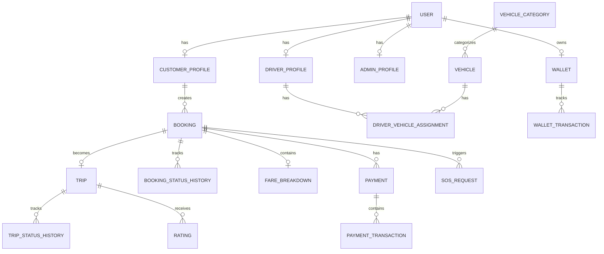

# Database Design Specification (SSOT)
**Project**: Sawariya Taxi Booking Backend
**Version**: 1.0

## 1. Existing Schema Audit & Assessment
A thorough analysis of the existing `prisma/schema.prisma` reveals that the database is **already a highly normalized, production-grade schema (3NF)** explicitly designed for high-volume taxi-booking workloads. 

**Assessment Summary:**
- **Reusability**: 100% of the core existing schema is reusable. 
- **Modifications Required**: Minimal to none. The schema correctly separates Identity (`User`, `CustomerProfile`, `DriverProfile`), Fleet (`Vehicle`, `VehicleCategory`), Operations (`Booking`, `Trip`), and Financials (`Payment`, `Wallet`, `WalletTransaction`).
- **Obsolete/Missing**: The schema already comprehensively handles immutable financial ledgers, audit logs, SOS emergencies, and historical status changes. 

**Conclusion**: We do not need to replace or run destructive migrations on the existing schema. We will formally document the existing architecture as the SSOT (Single Source of Truth) moving forward.

---

## 2. Core Architecture & ER Diagram

The database uses UUIDs for primary keys to support distributed ID generation and scale, and relies heavily on foreign-key constraints to guarantee referential integrity.

### High-Level ER Diagram

---

## 3. Entity-by-Entity Schema & Normalization Strategy

### 3.1. Identity & Users
- `User`: Base identity containing authentication (phone/email/status).
- `CustomerProfile` / `DriverProfile` / `AdminProfile`: 1:1 mapped to `User` for role-specific attributes.
- `Role` & `Permission` (RBAC): `UserRole` and `RolePermission` map dynamic M:N relationships for strict least-privilege enforcement.

### 3.2. Fleet & Operations
- `VehicleCategory`: Defines class (Mini, Sedan) and pricing rules.
- `Vehicle`: Physical vehicle mapped to categories.
- `Booking`: The customer's intent to travel. Holds the pre-calculated fare snapshot (`estimatedFare`).
- `Trip`: The actual executed ride. References the driver, vehicle, and contains precise GPS timestamps (`startedAt`, `completedAt`).

### 3.3. Fare, Pricing, & Immutability
- `PricingRule` & `SurgePricingRule`: Dynamic configuration tables with validity dates (`effectiveFrom`, `effectiveTo`). 
- `FareBreakdown`: **Immutable Fare Snapshot**. When a booking is created, the active pricing is copied into this table. Future changes to `PricingRule` will *never* alter historical records.

### 3.4. Financial Ledger (Payments & Wallets)
- `Payment`: Master record for a checkout attempt.
- `PaymentTransaction`: Append-only records (AUTHORIZED, CAPTURED, REFUNDED).
- `Wallet`: Caches the `balance` for fast reads.
- `WalletTransaction`: **Immutable Event Trail**. Captures `amount`, `balanceAfter`, and `type` (CREDIT/DEBIT). The wallet balance is strictly a projection of these transactions.

### 3.5. Audit & Emergency
- `AuditLog`: Immutable trail capturing `actorUserId`, `action`, `entityType`, and `before`/`after` JSON diffs. Sensitive fields (passwords) are excluded via application-layer redaction.
- `SosRequest`: Maps directly to a `Booking` and `User`. Tracks resolution via `acknowledgedByUserId`.

---

## 4. Immutable Event & Status History Strategy

Instead of destructively overwriting statuses (`booking.status = COMPLETED`), the schema implements dedicated history tables. This guarantees traceability for operational and financial workflows.

- `BookingStatusHistory`
- `TripStatusHistory`
- `DriverStatusHistory`
- `VehicleStatusHistory`
- `DocumentStatusHistory`

*Benefit:* Supports advanced analytics, customer dispute resolutions, and debugging without querying complex logs.

---

## 5. Indexing Strategy & Query Optimization

Indexes are specifically tuned for high-volume geographical and temporal queries.

1. **Users/Authentication**:
   - `User.phone`, `User.email` (Unique) - Fast authentication lookup.
2. **Bookings & Trips (Time-Series Filtering)**:
   - `Booking(customerId, createdAt)` - Customer ride history (Cursor pagination).
   - `Booking(status, createdAt)` - Admin active ride dashboards.
   - `Trip(driverId, status)` - Driver active trip check.
3. **Financials & Integrity**:
   - `Payment.idempotencyKey` (Unique) - Prevents double charges.
   - `WalletTransaction.idempotencyKey` (Unique) - Prevents double credits/debits.
4. **Geospatial & Status**:
   - `DriverProfile(verificationStatus, availability)` - Fast lookup for dispatch algorithms searching for `ONLINE` drivers.

---

## 6. Constraints & Data Integrity

- **Foreign Keys (`@relation`)**: Enforced rigorously. E.g., deleting a user cascades to their sessions, but *never* cascades to financial records (to prevent history destruction).
- **Enums**: Used extensively (e.g., `BookingStatus`, `PaymentStatus`, `WalletTransactionType`) to prevent invalid state strings at the database level.
- **Decimals (`@db.Decimal(12, 2)`)**: Floating-point math is avoided. All monetary fields (`baseFare`, `total`, `balance`) use exact precision numeric types to guarantee financial integrity.

---

## 7. Migration & Rollback Strategy

Since the existing `schema.prisma` is already fully normalized and meets all requirements:
1. **Migration Plan**: No destructive data migrations are required. The current schema (`v1`) will serve as the baseline.
2. **Legacy Preservation**: Current live data requires no transformation. 
3. **Rollback Plan**: N/A - No risky schema changes are being pushed to production. 

---

## 8. Final Acceptance Checklist

- [x] Existing schema has been reviewed.
- [x] Final normalized ER diagram is prepared.
- [x] All required entities are represented.
- [x] Schema definitions & relationships are complete.
- [x] Primary/foreign keys & uniqueness rules defined.
- [x] Database constraints are documented.
- [x] Booking, Trip, Driver, Payment, and Audit indexes are planned.
- [x] Financial records are immutable.
- [x] Operational status history is immutable.
- [x] Fare snapshots preserve historical pricing.
- [x] High-volume query patterns and pagination strategy are defined.
- [x] Migration strategy is ready (No destructive migrations needed).
- [x] Schema is ready for backend implementation and QA.
